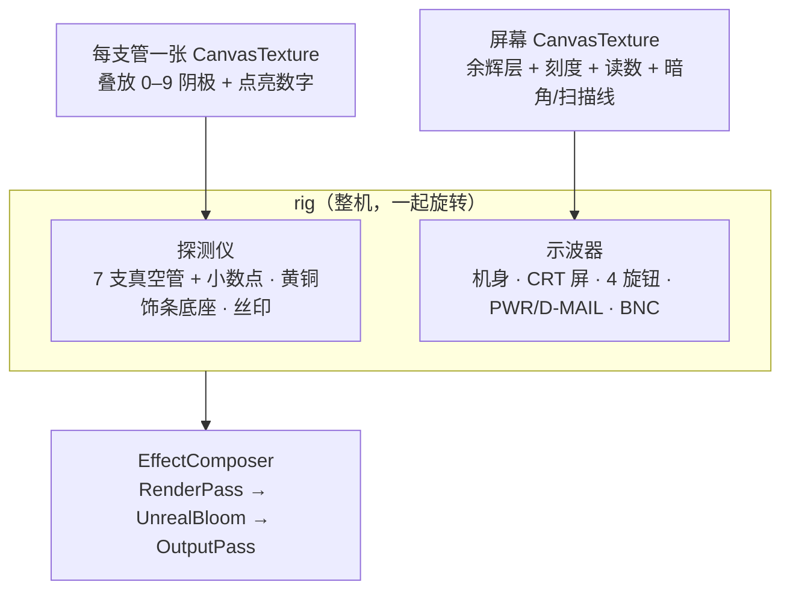
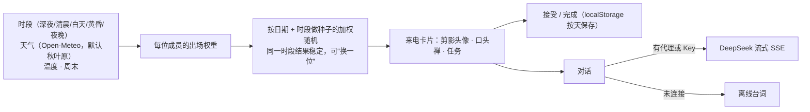

# 2026-10-29 FG-204 3D 示波器 · D-Mail 动画 · 研究所来电

## 1. 首页：FG-204 世界线示波器（`src/scope-device.ts`）

一个 three.js 场景里装着两台“仪器”：上面是世界线变动率探测仪，下面是示波器。它们共用灯光、Bloom 和配色，并且一起旋转。

| 部件 | 实现 |
|---|---|
| 机身 / 面板 | `RoundedBoxGeometry`，PBR 金属材质，`RoomEnvironment` 生成环境光照 |
| CRT | 圆角挤出边框（Shape + hole）；屏幕和玻璃都是弯曲平面（顶点按 `1-x²` 鼓起） |
| 屏幕内容 | 每帧：余辉层按 TIME 旋钮衰减 → 叠加波形（宽辉光 + 主线 + 白芯三遍描边）→ 刻度、读数 → 暗角、扫描线 |
| 波形模式 | `WORLD LINE`（近 120 天条目数滚动）/ `SINE` / `LISSAJOUS`（TIME 决定频率比）/ `DIVERGENCE`（大字读数） |
| 真空管 | `LatheGeometry` 玻璃壳 + `WireframeGeometry` 阳极网 + 加法混合的数字平面 + 插座和黄铜环 |
| 交互 | Raycaster 命中旋钮：拖动或滚轮调节，MODE 点击切换；按键带按下动画；PWR 播放 CRT 关机/开机动画；其余区域拖动旋转整机（触屏只接管横向拖动） |
| 顺滑 | three.js 只在首页懒加载（gzip 约 142KB）；像素比上限 1.75，手机 1.5、关闭抗锯齿；离屏或标签页隐藏时暂停；减少动态效果时按需渲染 |

## 2. D-Mail（`src/dmail.ts` + `calendar.ts` `sendDMail()`）

D-Mail = 随机挑一个有记录的过去日子“送回去”：

1. **COMPOSE（0–0.75s）**：复古手机屏逐字打出 ≤36 字节的消息（致敬原作 D-Mail 的长度限制）
2. **DISCHARGE（0.75–1.75s）**：手机屏坍缩成光点；用中点位移法每帧重新生成的电弧劈向示波器屏幕，目标处有三层旋转的时钟刻度环；同时示波器屏幕播放突发信号
3. **LEAP（1.75–2.6s）**：白闪，探测仪重新滚动到那一天的世界线数值（有记录 β = 1.xxxxxx，无记录 α = 0.xxxxxx），下方面板切换到那一天

示波器上的 D-MAIL 按键和首屏按钮走同一个流程。点击遮罩可以跳过。

## 3. 今日任务（`members.ts` / `weather.ts` / `mission.ts` / `ai.ts`）

- **出场规则示例**：深夜 → 红莉栖 / 至；清晨 → 真由理；下雨 → 琉华；阴天、起雾 → 萌郁；黄昏晴天 → 铃羽；周末白天 → 菲利斯；≥29°C → 至
- **人设提示词**：角色人设 + 当前时间与天气 + 当前任务；限制简体中文、每次回复 ≤90 字、可以用口头禅但不复述原作台词
- **DeepSeek 接入**：
  - 推荐：`worker/deepseek-proxy.js`（Cloudflare Worker）。Key 存在 Worker secret 里，只允许 `ALLOWED_ORIGINS` 来源调用，并限制条数和长度。构建时用 GitHub Actions 变量 `AI_PROXY_URL` 注入 `VITE_AI_PROXY`
  - 本地试玩：页面里填自己的 Key，只存在浏览器 localStorage 里
- **形象与语音**：官方立绘和原声有版权，不随站点分发。默认头像是原创逆光剪影（发型、服饰、标志物参数化 SVG）；语音用浏览器语音合成，优先挑选系统里的神经网络语音，每个角色的音高和语速不同。`public/characters/manifest.json`、`public/voices/manifest.json` 可以登记自有或已获授权的素材来替换

## 4. 已知限制

- 当前开发机所在网络无法访问 Open-Meteo 和 DeepSeek（TLS 握手失败），实测走的是离线降级：天气显示“离线”，对话使用离线台词
- 无头 Chrome 只有软件 WebGL（约 8fps），不代表真实 GPU 上的帧率；真实设备的帧率需要在浏览器里确认
