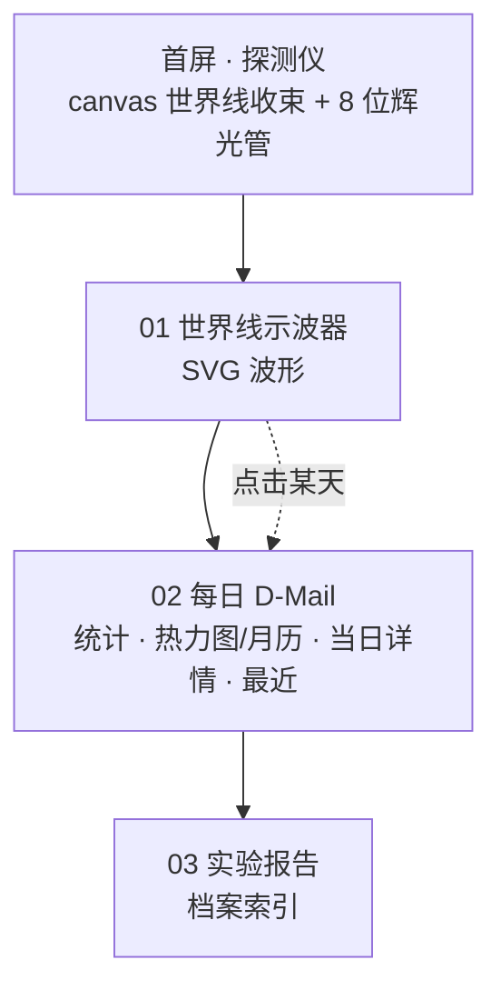

# 2026-10-29 UI v3 · DIVERGENCE

## 背景

v2 的结构仍是“深色卡片堆叠的仪表盘”，主题元素只是点缀。v3 改为电影感、叙事式的单页：首屏讲世界线收束，下面三章依次是示波器、每日 D-Mail、实验报告。

## 页面结构

## 关键实现

| 部件 | 文件 | 要点 |
|---|---|---|
| 世界线背景 | `src/worldline.ts` `mountThreads` | 18 条线 `y = 中线 + 偏移 × |x−cx|^1.6 + 摆动`，在中心收束；两端向中心流动的光点；IntersectionObserver 离屏暂停 |
| 示波器 | `src/worldline.ts` `mountScope` | 365 天条目数，7 日三角核平滑成主波形，原始值画成脉冲柱；按容器实际宽度生成 SVG（不拉伸），ResizeObserver 重绘；`pathLength=1` + dashoffset 动画描线；点击回调 `select()` |
| 辉光管 | `src/calendar.ts` `tubes()` + CSS | 每根管 = 叠放 0–9 描边数字（阴极）+ 点亮数字；60°/−60° 网格模拟阳极；`--w` 一个变量缩放整根管；`-webkit-box-reflect` 倒影 |
| LED 热力图 | CSS `.cell` | 圆形 + 内高光/内阴影；L2–L4 逐级外发光 |
| 档案索引 | `render.ts` `card()` | `ol.dossier > li > a.report`，描边大编号悬停填充；筛选时隐藏整行 `li` |
| 报告页 | `render.ts` `article()` | 描边大编号、红色双线印章（入场盖章动画）、REPORT/DATE/READ/FIGURES/TAGS 规格表 |
| 页头 | `render.ts` `layout()` + `lab.ts` | 粘性 HUD 栏，`01 观测站 / 02 实验报告`，实时时钟，新闻条 |
| 字体 | `@fontsource/chakra-petch`、`@fontsource/share-tech-mono` | 随构建自托管，不依赖 Google Fonts |

移除 `src/gears.ts`（齿轮钟面），首屏改用世界线背景。

## 踩坑

- **手机端横向溢出 458px**：报告页印章入场动画从 `scale(2.2)` 开始，那一瞬间内容变宽，移动端浏览器据此扩大布局视口且不再缩回。`.report-head{overflow-x:clip}` 解决，另外按视口缩小编号和印章
- **示波器变形**：最初用 `preserveAspectRatio="none"`，圆点和文字被拉伸，改为按实际宽度出图

## 验证

`npm run build` 通过；无头 Chrome 检查 15 篇报告的 24 张图全部渲染、无控制台错误；1440 / 390 宽度无横向溢出；标签筛选、示波器点击、D-Mail 正常。
