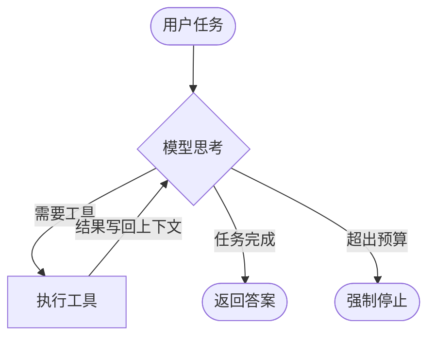

> 观测目标：用最少的代码，复现一个能自己决定“下一步做什么”的程序。

## 一句话定义

普通的 LLM 调用是**函数**：输入一段文本，输出一段文本，结束。

Agent 是**循环**：模型看到当前状态，决定调用某个工具；工具的结果回到模型的上下文里；模型再决定下一步——直到它认为任务完成。

区别不在模型多聪明，而在 **控制权**：在 Agent 里，“下一步做什么”是模型决定的，而不是你写死的。

## 最小循环



用代码写出来，比图还短：

```ts
async function runAgent(task: string, tools: Tool[]) {
  const messages: Message[] = [{ role: 'user', content: task }];
  for (let step = 0; step < 20; step++) {
    const reply = await llm.chat({ messages, tools });
    messages.push(reply);
    if (!reply.toolCalls?.length) return reply.text;      // 模型不再调用工具 → 结束
    for (const call of reply.toolCalls) {
      const result = await execute(tools, call);          // 真正干活的地方
      messages.push({ role: 'tool', id: call.id, content: result });
    }
  }
  throw new Error('超过最大步数，世界线没有收束');
}
```

这 15 行就是所有 Agent 框架的内核。剩下的一切——记忆、规划、多 Agent、评测——都是在回答同一个问题：**怎么让这个循环更可靠**。

## Workflow 还是 Agent？

不是所有任务都需要 Agent。一个好用的判断表：

| 维度 | Workflow（写死流程） | Agent（模型决定流程） |
|---|---|---|
| 步骤是否可预知 | 是 | 否 |
| 可调试性 | 高 | 中，需要 trace |
| 成本 | 低且稳定 | 高且波动 |
| 适合 | 翻译、分类、抽取 | 调研、编码、排障 |

经验法则：**能用 workflow 解决的，就不要上 agent**。Agent 的价值在于处理“你事先没想到的路径”。

## 三个常见误解

1. **“Agent 需要一个复杂框架”**：不需要。先写裸循环，等痛点出现再抽象。
2. **“模型越强，Agent 越好”**：工具设计和上下文质量往往比换模型影响更大。
3. **“让它自己跑就行”**：没有终止条件和预算的 Agent，会在某条世界线上无限循环。

## 小结

- Agent = 模型 + 工具 + 循环 + 终止条件
- 控制流的决定权交给模型，是收益也是风险
- 后续报告会逐一拆解循环里的每个零件
