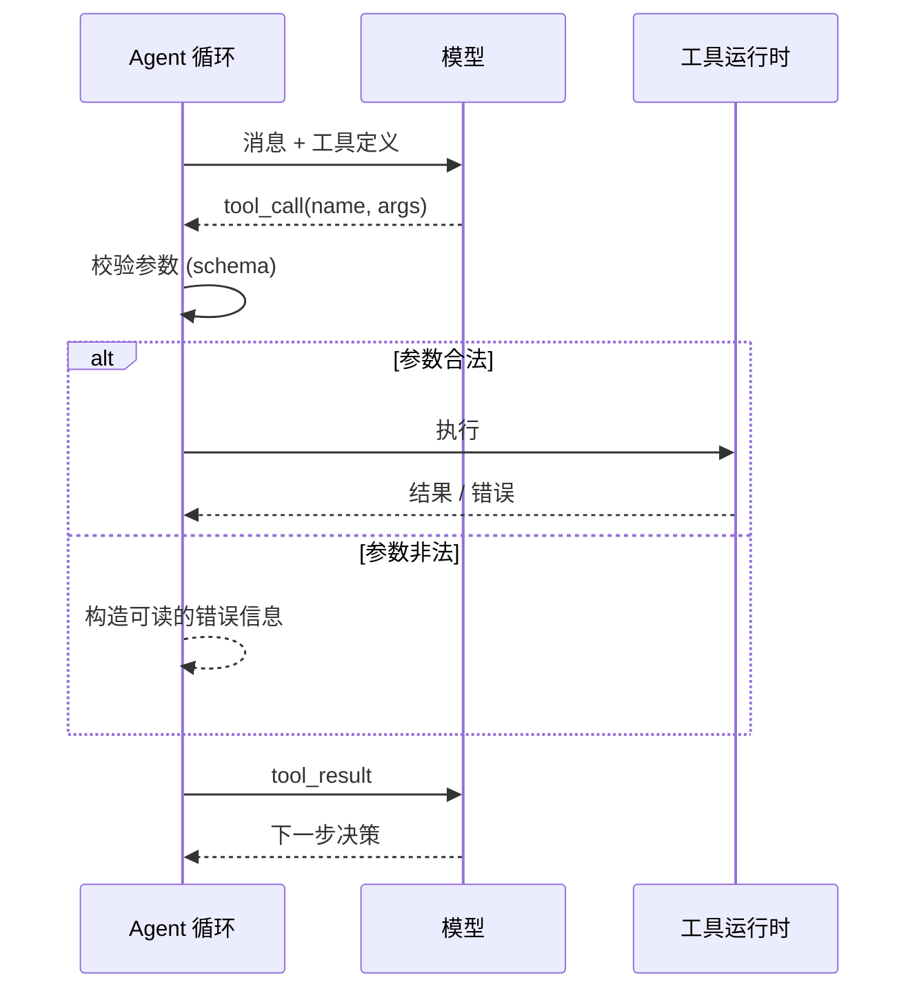

## 工具是写给模型看的 API

人类开发者读 API 文档时会自己脑补上下文，模型不会。它只看得到你给的 **名字、描述和 JSON Schema**。所以设计工具的第一原则是：

> 把工具描述当成写给一个聪明但完全不了解你系统的新同事的入职文档。

## 一次工具调用的生命周期



## 好工具 vs 坏工具

```json
{
  "name": "search",
  "description": "搜索",
  "parameters": { "q": { "type": "string" } }
}
```

上面这个工具，模型不知道搜的是什么、返回什么、什么时候该用。改一下：

```json
{
  "name": "search_issues",
  "description": "在公司 issue 系统中按关键词搜索工单。返回最多 10 条，按更新时间倒序。只搜索标题和正文，不搜索评论。当用户提到 bug、工单、需求编号时使用。",
  "parameters": {
    "type": "object",
    "properties": {
      "query": { "type": "string", "description": "关键词，支持 AND/OR" },
      "status": { "type": "string", "enum": ["open", "closed", "all"], "default": "open" }
    },
    "required": ["query"]
  }
}
```

## 设计清单

- [x] **名字带动词和领域**：`search_issues` 优于 `search`
- [x] **描述写清何时用、何时不用**
- [x] **用 enum 约束取值**，少让模型猜
- [x] **返回精简结果**：别把 2MB 的 JSON 原样塞回上下文
- [x] **错误信息可操作**：告诉模型怎么改，而不只是“失败”
- [ ] 一个工具做十件事（反例：`do_anything(action, payload)`）

## 错误也是一种提示

```ts
function toolError(e: unknown, call: ToolCall): string {
  if (e instanceof NotFoundError)
    return `找不到 id=${call.args.id} 的文件。可以先调用 list_files 查看可用的 id。`;
  if (e instanceof TimeoutError)
    return `执行超时（>30s）。请缩小查询范围后重试。`;
  return `未知错误：${String(e).slice(0, 200)}`;
}
```

模型非常擅长根据错误信息自我修正——前提是你告诉了它**下一步该做什么**。

## 粒度：多少个工具合适？

| 工具数量 | 现象 |
|---|---|
| 1–5 | 模型选择准确，但能力受限 |
| 5–20 | 甜区，大多数 Agent 在这里 |
| 20+ | 选择困难，需要分组、按需加载或拆成子 Agent |

工具不是越多越好。每增加一个工具，都在稀释模型对其他工具的注意力。
