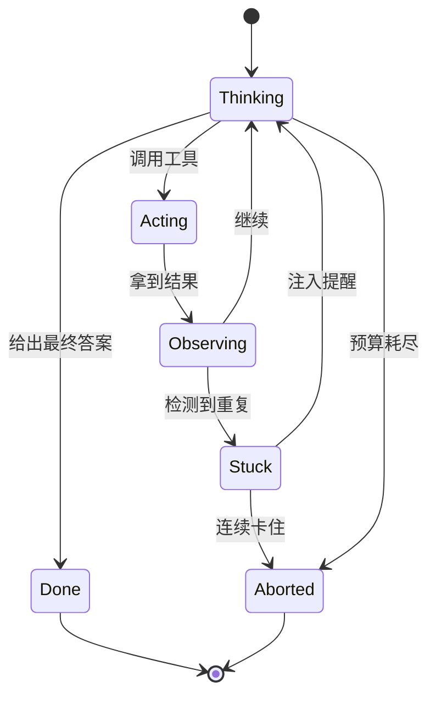

## 为什么 Agent 会停不下来

常见的死循环模式：

1. **重复调用**：同一个工具、同样的参数，调用了 8 次
2. **振荡**：改 A → 测试失败 → 改回 A → 测试失败……
3. **目标漂移**：在子任务里越钻越深，忘了原始目标
4. **永不满足**：模型总觉得“还可以再检查一下”

## Agent 的状态机



## 四种预算

| 预算 | 典型上限 | 超限处理 |
|---|---|---|
| 步数 | 20–50 步 | 要求模型总结并结束 |
| Token | 按任务估算 | 压缩上下文或终止 |
| 墙钟时间 | 5–30 分钟 | 保存检查点后退出 |
| 金额 | 每任务 $x | 硬停止并告警 |

```ts
class Budget {
  constructor(private limits: { steps: number; tokens: number; ms: number }) {}
  private used = { steps: 0, tokens: 0, start: Date.now() };

  charge(tokens: number) { this.used.steps++; this.used.tokens += tokens; }

  check(): 'ok' | 'warn' | 'stop' {
    const ratio = Math.max(
      this.used.steps / this.limits.steps,
      this.used.tokens / this.limits.tokens,
      (Date.now() - this.used.start) / this.limits.ms,
    );
    return ratio >= 1 ? 'stop' : ratio >= 0.8 ? 'warn' : 'ok';
  }
}
```

## 软着陆而不是硬切断

预算到 80% 时，往上下文里注入一条系统提醒，比直接 kill 好得多：

> 你已使用 80% 的步数预算。请停止探索新方向，整理目前的发现，在接下来 3 步内给出结论。

模型通常能很好地响应这种提示，交出一份“虽不完美但可用”的结果。

## 重复检测

```python
from collections import Counter

def detect_loop(calls: list[tuple[str, str]], window: int = 6, threshold: int = 3) -> bool:
    """最近 window 次调用里，同一 (工具, 参数) 出现 threshold 次即视为卡住"""
    recent = Counter(calls[-window:])
    return any(n >= threshold for n in recent.values())
```

检测到之后，不要立刻终止——先告诉模型“你似乎在重复同一个操作，换个思路”。给一次机会，再卡住才中止。

## 小结

终止条件不是事后补丁，而是 Agent 设计的第一等公民。**先写好怎么停，再写怎么跑。**
