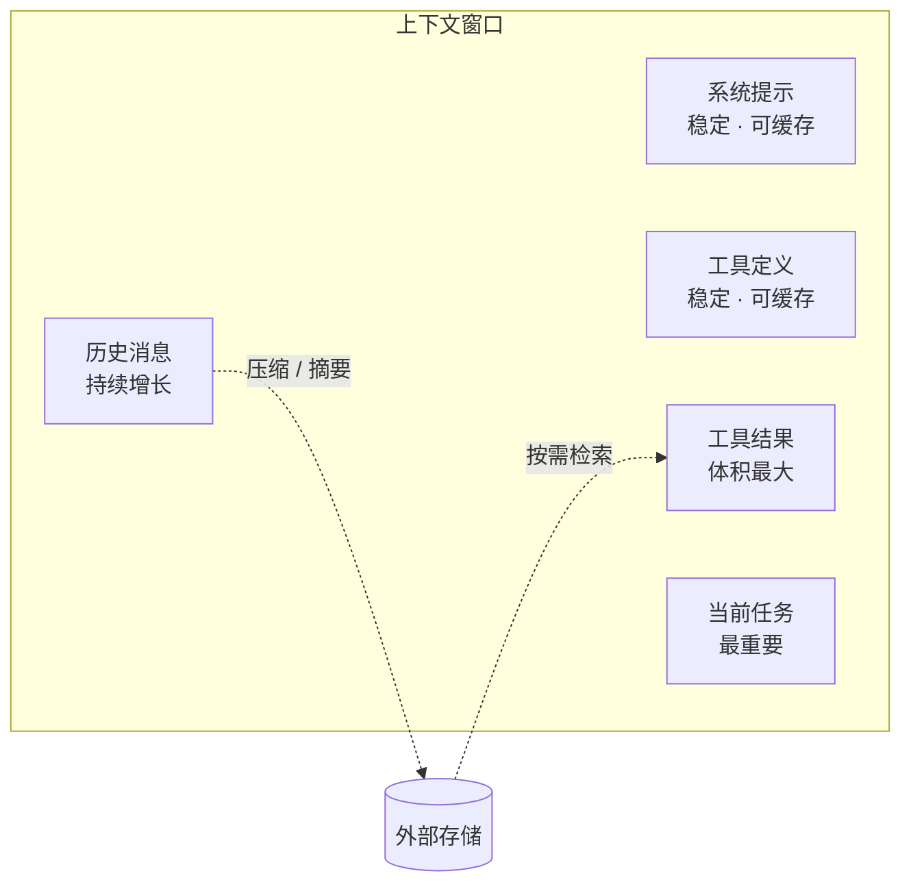

## 从 Prompt 到 Context

早期我们花大量时间打磨一段提示词。但在 Agent 里，提示词只占上下文的一小部分，更多的是：

- 工具定义
- 历史对话与工具结果
- 检索到的文档
- 中间产物（计划、笔记、草稿）

**上下文工程** 就是决定这些东西什么时候进、什么时候出、以什么形态存在。

## 上下文的组成



## 四个基本操作

| 操作 | 做法 | 适用场景 |
|---|---|---|
| **写入** | 把信息放进上下文 | 当前步骤必需的信息 |
| **选择** | 只检索相关片段 | 大文档、代码库 |
| **压缩** | 摘要、截断旧结果 | 长任务中期 |
| **隔离** | 交给子 Agent，在独立窗口处理 | 探索性子任务 |

## 工具结果是最大的污染源

一次 `cat` 大文件、一次返回 500 行的搜索，就能吃掉几万 token。处理原则：

```ts
function clip(result: string, max = 4000): string {
  if (result.length <= max) return result;
  const head = result.slice(0, max * 0.7);
  const tail = result.slice(-max * 0.2);
  return `${head}\n\n…[已截断 ${result.length - max} 字符，可用 offset 参数读取剩余部分]…\n\n${tail}`;
}
```

注意截断提示里告诉了模型**如何获取剩余部分**——这比静默截断有用得多。

## 压缩：什么时候、压什么

- 触发：上下文用量超过窗口的 60–70%
- 保留：原始任务、最终决策、未解决的问题、关键文件路径
- 丢弃：已经被后续步骤取代的中间结果、重复的工具输出

```python
COMPACT_PROMPT = """总结以上对话，供你自己在新的上下文中继续工作。
必须保留：用户的原始目标；已完成的步骤与结论；修改过的文件；尚未解决的问题。
可以丢弃：探索中被否定的路径、工具输出原文。"""
```

## 位置也很重要

模型对上下文开头和结尾的信息更敏感。实践中：

1. **稳定内容放前面**（系统提示、工具），有利于缓存
2. **当前任务和最新提醒放最后**，离模型的“注意力”最近
3. 长文档里的关键信息，在末尾再复述一次要点

## 小结

窗口不是越大越好用。好的上下文工程让模型在 **少量、相关、新鲜** 的信息上做决策。
