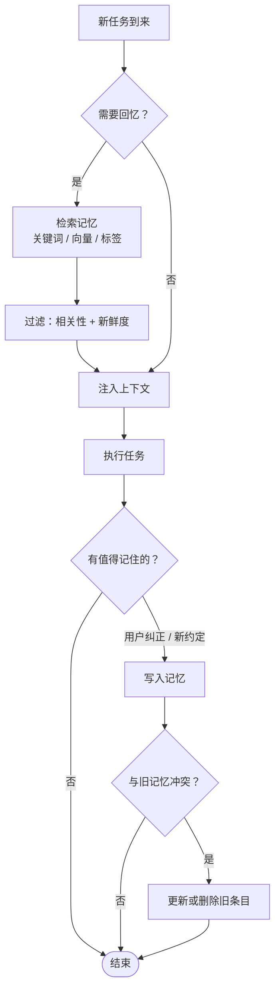

## 三层记忆

借用认知科学的分类：

| 类型 | 类比 | Agent 中的实现 | 生命周期 |
|---|---|---|---|
| 工作记忆 | 脑子里正在想的 | 上下文窗口 | 单次会话 |
| 情景记忆 | “上次那件事” | 历史会话摘要、日志 | 数周 |
| 语义记忆 | 常识与事实 | 知识库、偏好文件 | 长期 |

## 记忆的读写流程



## 最简单的记忆：一个 Markdown 文件

不要一上来就搭向量数据库。很多场景下，一个由 Agent 自己维护的文件就够了：

```md
# 项目记忆
- 用户偏好用 pnpm，不要用 npm
- 测试命令是 `pnpm test --run`，不要用 watch 模式
- 2026-04-30：部署脚本需要先手动登录 VPN（踩过坑）
```

优点：人类可读、可编辑、可以放进 git、可以审查。

## 什么值得记住

写入记忆的门槛要高，否则记忆会变成垃圾场：

- ✅ 用户明确的纠正（“别这么做”）
- ✅ 不能从代码或文档推导出来的约定
- ✅ 花了很大代价才发现的坑
- ❌ 当前任务的临时状态
- ❌ 代码里已经写着的信息
- ❌ 可能很快过时的数字

## 检索：别只用向量

```ts
async function recall(query: string, k = 5): Promise<Memory[]> {
  const [byKeyword, byVector] = await Promise.all([
    store.searchText(query, k * 2),
    store.searchEmbedding(await embed(query), k * 2),
  ]);
  // 融合排序：两路结果都出现的条目优先，再按更新时间加权
  return rerank([...byKeyword, ...byVector], { recencyHalfLifeDays: 30 }).slice(0, k);
}
```

向量检索擅长“意思相近”，关键词检索擅长“精确匹配”（文件名、错误码）。两者结合效果最好。

## 遗忘也是功能

记忆需要维护：

1. 冲突时以新的为准，并删除旧的
2. 定期合并重复条目
3. 带日期的记忆，过期后降低权重

> 一个从不遗忘的 Agent，最终会被过时的记忆误导。
