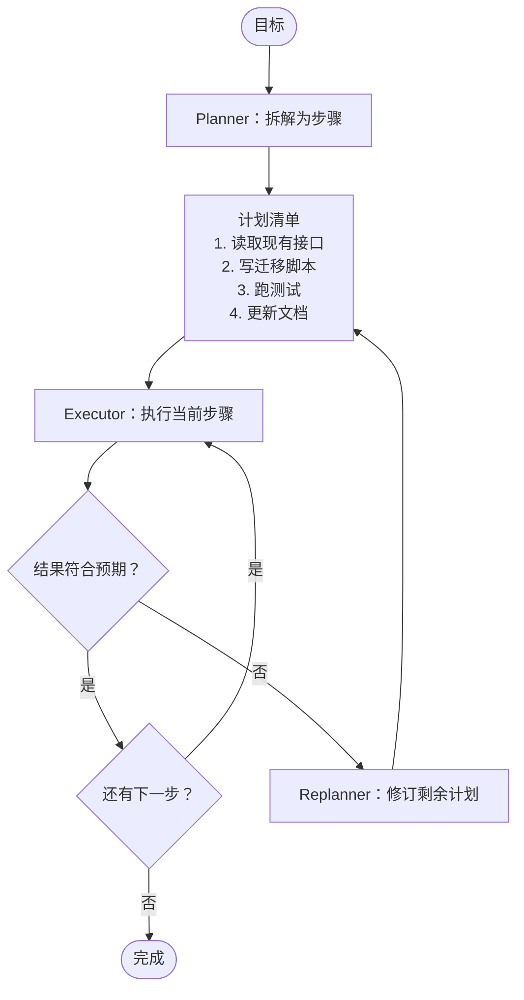

## ReAct：边想边做

ReAct（Reason + Act）是最朴素的范式：每一步先推理，再行动，再观察。


- 优点：灵活，能根据观察随时调整
- 缺点：容易短视，长任务里会迷失方向

## Plan-and-Execute：先想后做

先让模型产出一份完整计划，再逐步执行：



关键在 **Replanner**：计划不是合同，而是假设。执行中发现假设错误时，要有机制更新它。

## 对比

| | ReAct | Plan-and-Execute |
|---|---|---|
| 短任务（< 5 步） | ✅ 简单高效 | 计划开销不划算 |
| 长任务（> 20 步） | 容易偏离目标 | ✅ 有全局视角 |
| 环境不确定性高 | ✅ 随机应变 | 需要频繁重规划 |
| 可解释性 | 中 | ✅ 计划本身就是文档 |

## 实践：把计划变成一个工具

最轻量的做法，是给 Agent 一个 `update_plan` 工具，让它自己维护待办清单：

```ts
const updatePlan = {
  name: 'update_plan',
  description: '维护任务清单。开始复杂任务时创建；完成或发现新情况时更新。每次只能有一个 in_progress。',
  parameters: {
    type: 'object',
    properties: {
      items: {
        type: 'array',
        items: {
          type: 'object',
          properties: {
            step: { type: 'string' },
            status: { type: 'string', enum: ['pending', 'in_progress', 'done', 'dropped'] },
          },
        },
      },
    },
  },
};
```

这个工具本身不做任何事，但它迫使模型 **显式地** 思考全局，而计划会一直留在上下文里提醒它。

## 什么时候该回溯

回溯的信号：

1. 连续两步的结果都和预期不符
2. 发现最初的假设是错的（“原来这个项目用的不是 REST”）
3. 当前路径的成本远超预估

回溯不丢人。**坚持一个错误的计划，才是最昂贵的。**
