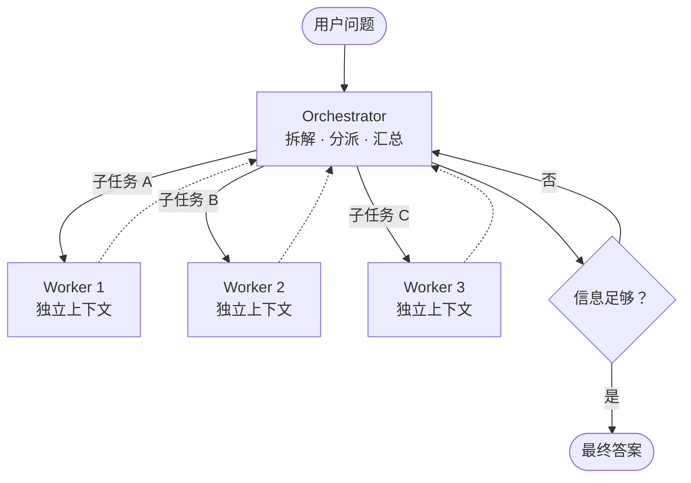
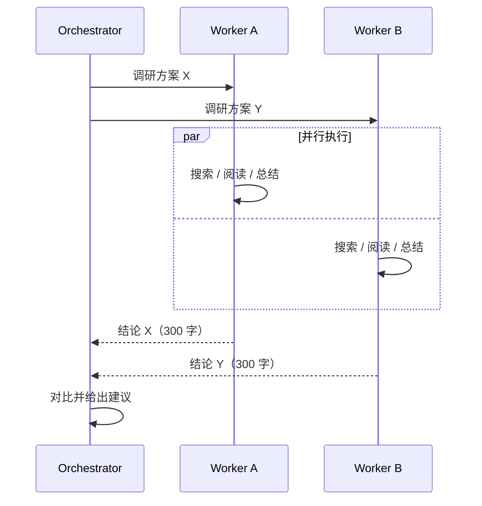

## 为什么要多个 Agent

单个 Agent 的瓶颈通常不是智力，而是 **上下文**：

- 调研 10 个方向，每个方向的资料都塞进同一个窗口，很快就满了
- 前面的探索噪音会干扰后面的判断

多 Agent 的本质收益是：**每个子 Agent 拥有一个干净的上下文窗口**，只把结论交回来。

## Orchestrator-Worker



虚线是 Worker 交回的 **精简结论**——几百字，而不是它读过的几万字原文。

## 时序：并行才是重点



## 给 Worker 写任务说明

Orchestrator 最常见的错误是任务说明太短。Worker 是“冷启动”的，它不知道你们之前聊过什么。

```md
## 任务
调研 Rust 中可用于嵌入式的异步运行时。

## 背景
用户在做 STM32 项目，内存 256KB，不能使用 std。

## 期望输出
- 3–5 个候选，每个附：维护状态、最小内存占用、是否支持 no_std
- 一句话推荐
- 不要贴代码，不超过 400 字

## 不要做
不需要调研桌面端运行时（tokio 等）。
```

## 什么时候不该拆

| 情况 | 原因 |
|---|---|
| 子任务之间强依赖 | 串行等待抵消了并行收益 |
| 需要共享大量细节 | 结论压缩会丢信息 |
| 任务本身很小 | 协调开销 > 收益 |
| 需要强一致的写操作 | 多个 Agent 同时改代码容易冲突 |

经验：**读多写少的任务适合拆（调研、审查），写多的任务适合单 Agent（编码）**。

## 成本提醒

多 Agent 系统的 token 消耗通常是单 Agent 的数倍。在为它付费之前，先确认任务真的值得。
