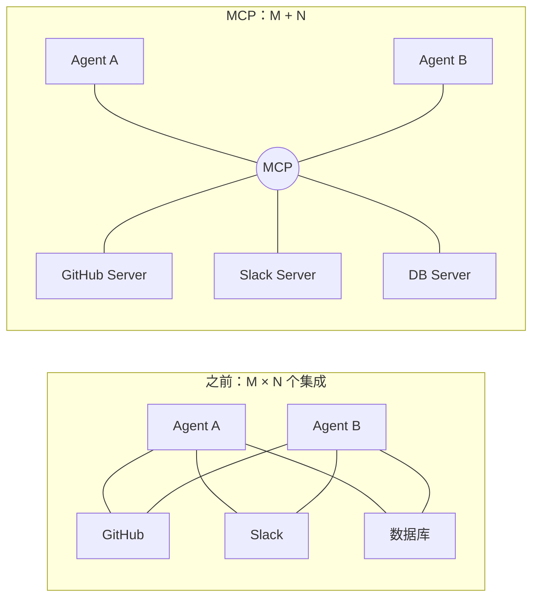
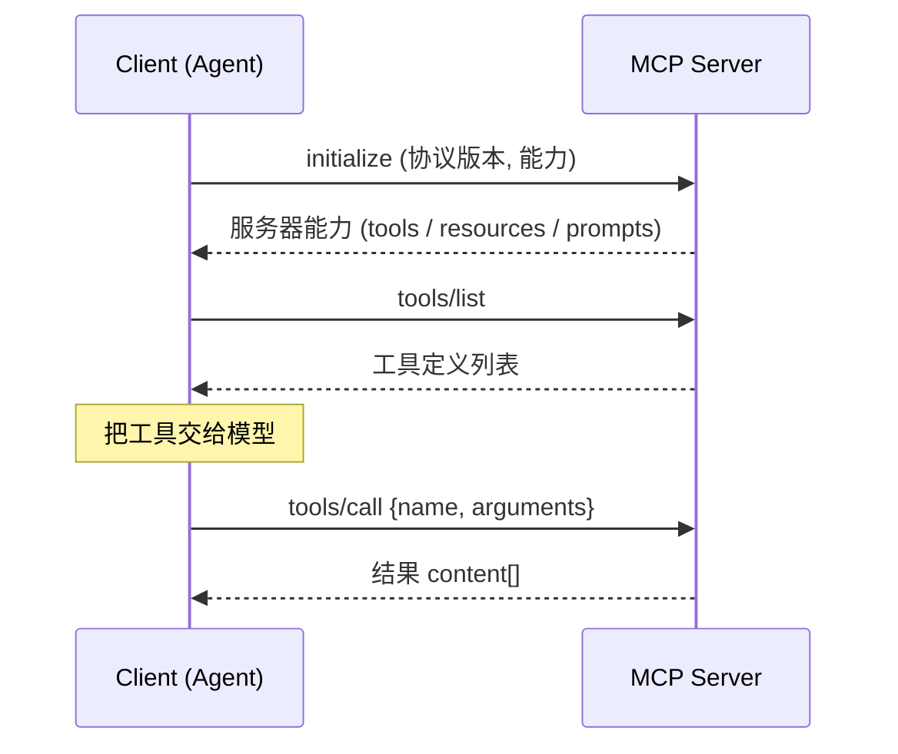

## MCP 解决的问题

没有 MCP 时，每个 Agent 应用都要为每个外部系统写一遍集成：



## 三种原语

| 原语 | 谁来控制 | 用途 | 例子 |
|---|---|---|---|
| **Tools** | 模型决定调用 | 执行动作 | `create_issue`、`run_query` |
| **Resources** | 应用决定加载 | 提供上下文数据 | 文件内容、数据库表结构 |
| **Prompts** | 用户主动选择 | 预置的提示模板 | “/review-pr” |

## 连接流程



## 一个最小 Server

```ts
import { McpServer } from '@modelcontextprotocol/sdk/server/mcp.js';
import { StdioServerTransport } from '@modelcontextprotocol/sdk/server/stdio.js';
import { z } from 'zod';

const server = new McpServer({ name: 'world-line', version: '1.0.0' });

server.tool(
  'divergence',
  '读取当前世界线变动率',
  { precision: z.number().int().min(1).max(6).default(6) },
  async ({ precision }) => ({
    content: [{ type: 'text', text: (1.048596).toFixed(precision) }],
  }),
);

await server.connect(new StdioServerTransport());
```

## 传输方式

- **stdio**：Server 作为子进程运行，适合本地工具（文件系统、git）
- **Streamable HTTP**：远程服务，适合 SaaS 集成，需要考虑鉴权

## 安全提醒

MCP Server 拿到的是 **真实的执行能力**：

1. 只安装你信任来源的 Server
2. 工具描述本身也可能包含提示注入——Server 返回的内容是数据，不是指令
3. 写操作类工具应配合人工确认（见《人在回路》）

> 协议让接入变简单了，但信任边界没有消失。
