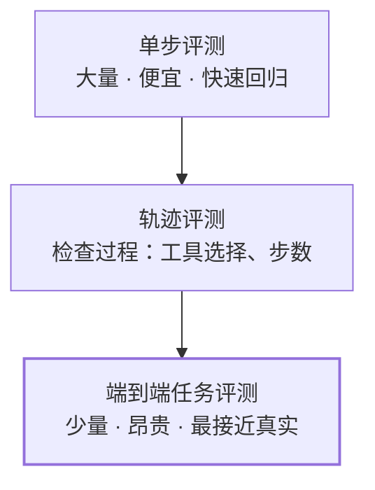
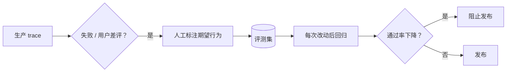

## 为什么 Agent 特别难测

- **非确定性**：同样的输入，两次运行可能走不同路径
- **多步骤**：最终答案对，过程可能很离谱（反之亦然）
- **副作用**：Agent 会修改文件、调用 API，评测环境要能重置

## 评测金字塔



| 层级 | 测什么 | 判定方式 |
|---|---|---|
| 单步 | 给定上下文，是否选对工具 / 参数 | 精确匹配 |
| 轨迹 | 是否在 N 步内完成、是否有危险操作 | 规则 + 模型评分 |
| 端到端 | 最终结果是否正确 | 单元测试、人工、模型评分 |

## 从真实失败中收集用例

最好的评测用例不是凭空想的，而是 **生产中真实失败的 trace**：



## 一个评测用例长什么样

```yaml
id: refactor-rename-001
task: "把 utils.ts 里的 fmtDate 重命名为 formatDate，并更新所有引用"
setup:
  repo: fixtures/small-ts-app
checks:
  - type: command
    run: "npx tsc --noEmit"
    expect: exit_code == 0
  - type: grep
    pattern: "fmtDate"
    expect: no_match
  - type: trajectory
    max_steps: 15
    forbidden_tools: [delete_file]
trials: 5   # 跑 5 次，统计通过率
```

## 模型当裁判

开放式输出（总结、报告）很难写规则。可以用另一个模型打分，但要注意：

1. **给出明确评分标准**，而不是“这个回答好不好”
2. **让裁判先给理由再给分**
3. **定期用人工标注校准裁判**，检查一致性

```python
JUDGE = """根据以下标准评估回答，每项 0-2 分：
1. 是否回答了用户的问题
2. 是否有事实错误（对照参考资料）
3. 是否遗漏了参考资料中的关键点
先逐项说明理由，最后输出 JSON：{"scores": [..], "total": n}"""
```

## 看通过率，不看单次

Agent 是概率性的。一个用例跑 1 次通过不说明问题，**跑 5–10 次的通过率** 才是有意义的指标。

> 没有 eval 的优化，只是在不同的世界线之间随机跳跃。
