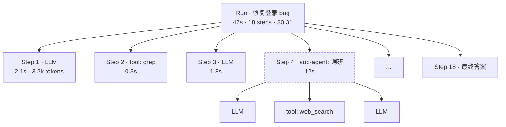
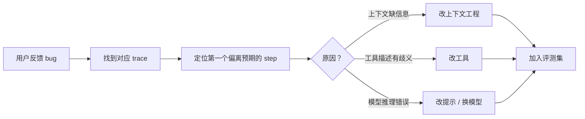

## 日志不够用

传统服务记录请求和响应就够了。Agent 一次任务可能有 30 步、5 次子 Agent 调用、上百 KB 的上下文变化。你需要的是 **树状的 trace**。

## Trace 的结构



## 每个 Span 记录什么

| 字段 | 说明 | 为什么重要 |
|---|---|---|
| `input` | 本步的完整上下文（或其哈希 + 增量） | 复现问题 |
| `output` | 模型输出 / 工具结果 | 看它“想了什么” |
| `tokens` | 输入、输出、缓存命中 | 成本分析 |
| `latency` | 首 token 时间、总时长 | 性能瓶颈 |
| `parent_id` | 父 span | 还原树结构 |
| `error` | 异常与重试次数 | 可靠性统计 |

## 最小实现

```ts
interface Span { id: string; parent?: string; name: string; start: number; end?: number; attrs: Record<string, unknown> }

class Tracer {
  spans: Span[] = [];
  async span<T>(name: string, parent: string | undefined, fn: (id: string) => Promise<T>): Promise<T> {
    const s: Span = { id: crypto.randomUUID(), parent, name, start: performance.now(), attrs: {} };
    this.spans.push(s);
    try { return await fn(s.id); }
    catch (e) { s.attrs.error = String(e); throw e; }
    finally { s.end = performance.now(); }
  }
}

// 用法
await tracer.span('run', undefined, async run => {
  const reply = await tracer.span('llm', run, () => llm.chat(req));
  await tracer.span(`tool:${call.name}`, run, () => execute(call));
});
```

生产环境建议直接对接 OpenTelemetry，用现成的后端做可视化。

## 用 Trace 回答的问题

1. **它为什么选了这个工具？** → 看这一步之前的上下文
2. **为什么这么慢？** → 按 latency 排序 span
3. **为什么这么贵？** → 按 tokens 排序，通常是某次工具结果太大
4. **哪类任务最容易失败？** → 聚合 run 级别的标签和结果

## 调试流程



最后一步最关键：**每个修复过的 bug 都应该变成一个评测用例**，防止它在另一条世界线上复活。
