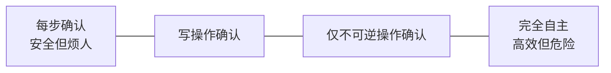
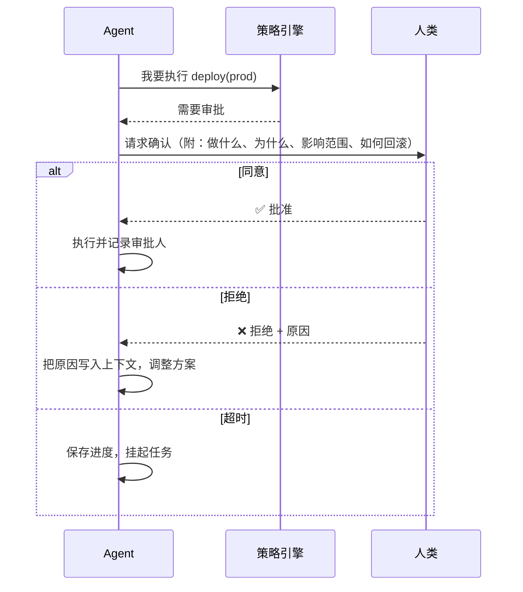

## 自主性光谱

没有统一的最优点。它取决于 **操作的可逆性** 和 **出错的代价**。

## 决策矩阵

| | 可逆 | 不可逆 |
|---|---|---|
| **影响小** | 直接做 | 做之前简短告知 |
| **影响大** | 做完汇报 | 必须确认 |

例子：

- 修改本地文件（可逆，git 能恢复）→ 直接做
- 发送邮件给客户（不可逆，影响大）→ 必须确认
- 删除临时目录（不可逆，影响小）→ 简短告知

## 审批流程

## 一个好的确认请求

❌ 坏的：

> 是否继续？[Y/n]

✅ 好的：

> **将要执行**：`git push --force origin feature/login`
> **原因**：rebase 后需要更新远端分支
> **影响**：覆盖远端 3 个提交（均为你本人提交，已包含在本地历史中）
> **回滚**：远端旧 HEAD 为 `a1b2c3d`，可随时恢复
> 是否继续？

人类应该能在 **5 秒内** 做出判断。

## 少问，问在点上

频繁打断会导致“确认疲劳”——用户开始无脑点“是”，审批就失去了意义。

减少打断的方法：

1. **批量确认**：把一组相关操作合并成一次审批
2. **会话内授权**：“本次任务中，允许修改 `src/` 下的文件”
3. **先做可逆的部分**：把需要确认的操作尽量推到最后
4. **记住偏好**：用户拒绝过的事，不要再问第二次

## 小结

人在回路不是为了推卸责任，而是承认：**有些决定，只有人才有资格做。**
