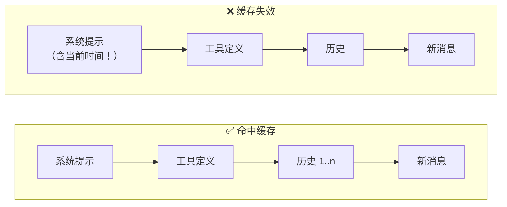

## 钱花在哪里

一个 20 步的 Agent 任务，每一步都要重新发送完整上下文：

```mermaid
gantt
    title 每一步发送的 token（示意）
    dateFormat X
    axisFormat %s
    section 系统提示+工具
    稳定前缀 :0, 20
    section 历史
    第 1 步 :0, 2
    第 5 步 :0, 8
    第 10 步 :0, 14
    第 20 步 :0, 20
```



上下文是 **累加** 的：第 20 步发送的内容包含了前 19 步的全部历史。总输入 token 大致与步数的平方成正比。

## 三板斧

| 手段 | 原理 | 典型节省 |
|---|---|---|
| 提示缓存 | 重复的前缀只计算一次 | 输入成本降低 50–90% |
| 模型路由 | 简单任务用小模型 | 整体降低 30–70% |
| 批处理 | 非实时任务异步提交 | 约 50% |

## 提示缓存：让前缀保持稳定

缓存按 **前缀** 匹配。只要前面的内容一字不差，就能命中。



破坏缓存的常见原因：

1. 系统提示里放了 **时间戳** 或随机 ID
2. 工具列表的 **顺序** 每次不同
3. 在历史中间 **插入或修改** 消息
4. 动态内容放在了前面而不是最后

```ts
// ❌ 每次请求都不同，缓存永远不命中
const system = `你是助手。当前时间：${new Date().toISOString()}`;

// ✅ 稳定前缀 + 动态内容放在最后一条消息里
const system = `你是助手。`;
messages.push({ role: 'user', content: `${task}\n\n(当前时间：${now})` });
```

## 模型路由

不是每一步都需要最强的模型：

```python
def route(step: Step) -> str:
    if step.kind in ("classify", "extract", "summarize_tool_output"):
        return "small"      # 快、便宜
    if step.kind == "plan" or step.retries > 0:
        return "large"      # 关键决策、或小模型已经失败过
    return "medium"
```

一个常见模式：大模型做 Orchestrator，小模型做 Worker。

## 批处理

评测、离线数据标注、夜间报告——这些任务不需要秒级响应。使用批处理接口，用延迟换价格。

## 小结

先测量，再优化。打开 trace，按 token 排序，**最贵的那一步通常会让你大吃一惊**。
