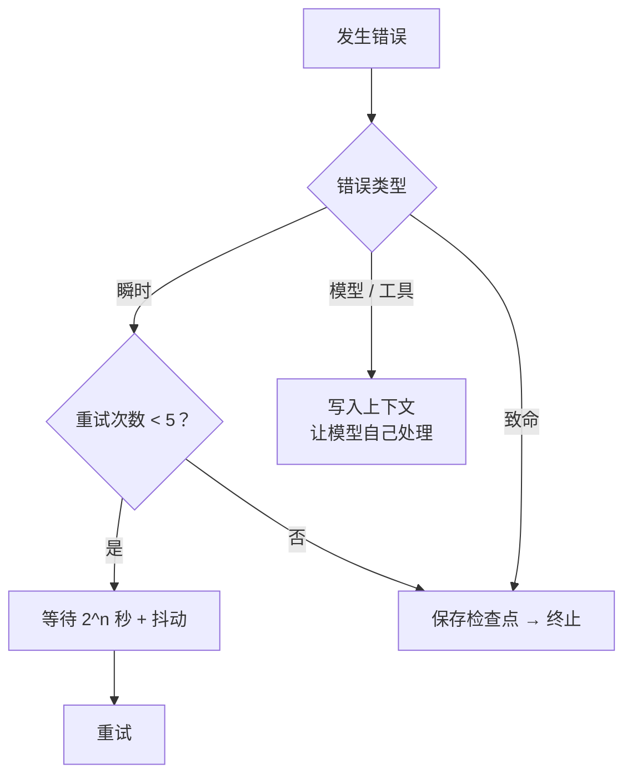
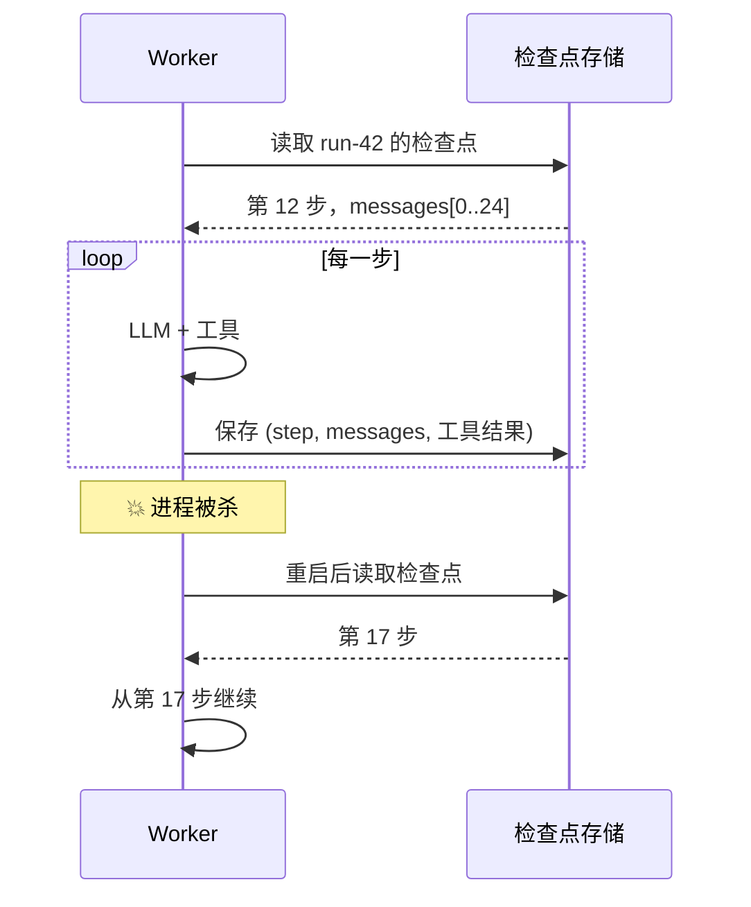

## 错误分类

不同的错误需要不同的处理方式：

| 类型 | 例子 | 处理 |
|---|---|---|
| 瞬时错误 | 429 限流、502、网络抖动 | 指数退避重试 |
| 模型错误 | 输出格式错误、参数不合法 | 把错误反馈给模型，让它修正 |
| 工具错误 | 文件不存在、命令失败 | 作为工具结果返回，交给模型决策 |
| 致命错误 | 鉴权失败、预算耗尽 | 保存检查点，终止 |

## 重试决策



```ts
async function withRetry<T>(fn: () => Promise<T>, max = 5): Promise<T> {
  for (let attempt = 0; ; attempt++) {
    try { return await fn(); }
    catch (e) {
      if (!isTransient(e) || attempt >= max) throw e;
      const retryAfter = getRetryAfter(e);                 // 优先遵守服务端给的等待时间
      const backoff = Math.min(60_000, 1000 * 2 ** attempt) * (0.5 + Math.random());
      await sleep(retryAfter ?? backoff);
    }
  }
}
```

## 幂等：重试的前提

如果“创建订单”这个工具超时了，你不知道它到底执行了没有。直接重试可能创建两个订单。

解决方法：**为每次工具调用生成幂等键**。

```ts
async function executeTool(call: ToolCall, runId: string) {
  const key = `${runId}:${call.id}`;                        // 同一次调用，键永远相同
  const cached = await store.get(key);
  if (cached) return cached;                               // 已经执行过，直接返回结果
  const result = await tools[call.name](call.args, { idempotencyKey: key });
  await store.set(key, result);
  return result;
}
```

## 检查点：从断点继续



检查点需要保存：

- 完整的消息历史（或可以重建它的增量）
- 已执行工具调用的结果（配合幂等键）
- 预算使用情况
- 计划 / 待办清单的当前状态

## 小结

可靠性不是让错误不发生，而是让错误 **发生了也没关系**。就像时间跳跃：只要记得自己在哪一步，就总能回到那里。
